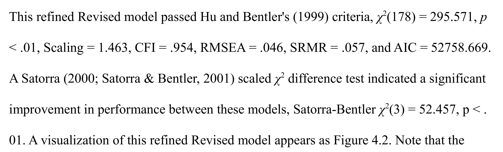
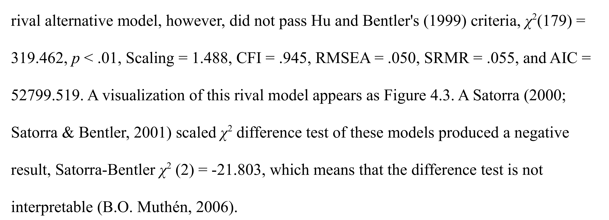

# Replication of Daniel Abbott 2010 dissertation

## Abstract

Does creative self-efficacy have distinguishable thinking and performance dimensions, and do Abbott's revised inventories measure them better than the tested alternatives? Abbott's University of Nebraska-Lincoln dissertation reports support for a two-dimension model after residual-correlation refinements, associations with other constructs, preference over four rival measurement models, and seven qualitative themes. We reconstructed eight structural models from the published correlation matrix and Mplus syntax, checked reported statistical calculations, and reviewed the qualitative evidence and source availability. **The principal quantitative pattern is partially reproduced, but the original empirical analysis is not replicated.** The reconstructed thinking-performance correlation is .860, and the revised model remains preferred under the stated comparison approximation. Original participant records, missingness patterns, and robust-estimation inputs were not obtained. Several printed-summary calculations do not agree with their stated formulas; these issues do not by themselves overturn the reported model preference.

## Main result and scope

The strongest supported conclusion is a partial reconstruction of the dissertation's quantitative pattern, not confirmation of all six hypotheses. The source's central contribution is a proposed creative-thinking self-efficacy (CTSE) and creative-performance self-efficacy (CPSE) measurement structure, connected to participants' accounts. Our calculation recovers a similar association between the dimensions and the same direction of model preference. It cannot establish the original robust fit criteria, significance tests, population validity, or qualitative replication.

The original analysis and our reconstruction use materially different information. Abbott uses Mplus 5.2, full-information maximum likelihood (FIML) with the MLR robust estimator, and 308 respondents, including incomplete cases (pp. 96-97, 125; Appendix J). Table 3.2 instead supplies a two-decimal correlation matrix labeled **n = 296**, alongside rounded means and standard deviations. The text separately reports 297 complete respondents. A covariance matrix cannot recover the original missingness patterns, higher moments, or robust standard errors. We therefore fit ordinary normal-theory maximum likelihood (ML) to published summary statistics. We did not create synthetic participant records.

The qualitative findings remain the original author's interpretations. Eight follow-up interviews generated seven themes: dark feelings, training, joy, normal, constraints, recognition, and internal blocking. The dissertation supplies selected excerpts and photographed coding sheets, but not a complete transcript corpus. Our source review preserves those findings without claiming to rerun interviews or independently reproduce their coding.

## Comparison overview

The comparison separates empirical claims from checks of printed summaries. Here, **match** means the stated calculation agrees at its specified precision; **close** means a small difference is compatible with rounding; **partial** means only a restricted part or changed-input reconstruction is supported; and **no match** means the specified printed-summary check fails under the stated reading. These labels do not grade the dissertation as a whole.

| Claim | Published | Ours | Verdict |
|---|---|---|---|
| H1 adequate fit of revised structure | MLR CFI .954, RMSEA .046, SRMR .057 | Original MLR/FIML fit not recoverable; plain-ML CFI .9386, RMSEA .0721, SRMR .0604 on rounded n296 matrix | partial |
| CTSE and CPSE association | .86 in expanded model, Table 4.1 | .8602 in refined model; .8614 in expanded model | partial |
| H2 preference over perfectly correlated higher-order rival | Rival AIC higher by 40.850 | Higher by 38.871 with rounded-summary ML | partial |
| H3 BCSE associations with CTSE and CPSE | .53 and .69 | .5283 and .6845 | partial |
| H4 openness associations with CTSE and CPSE | .45 and .53 | .4351 and .5232 | partial |
| H5 preference over All and Held models | Alternative AIC increments 235.089 and 338.690 | 234.132 and 315.576 under profiled-auxiliary comparison | partial |
| H6 preference over Implied Structure and Indicators | AIC increments 64.474 and 131.654 | 34.393 and 99.914 under same comparison | partial |
| Nine printed RMSEA calculations | .043 to .067 across models | All nine reproduce to three decimals from printed chi-square, df, n308 | match |
| Scaled difference after refinement, p130 | 52.457 on 3 df | 74.3889; rounding band 70.6365 to 78.5991 | no match |
| Scaled general-factor difference, p131 | -21.803 on 2 df | 7.2312 on difference of 1 df; band 7.0702 to 7.4022 | no match |
| Qualitative explanatory themes | Seven themes from eight interviews | Source account preserved; no new interviews or independent recoding | partial |

Each partial model row has the same central limitation: the input matrix and estimator differ from the original participant-data analysis. The model preferences concern the named rivals, not all possible factor structures. The H2 rival specifically forces the two standardized higher-order factors to correlate perfectly; it is not a general test against every possible general-factor or bifactor model. The positive recalculated difference statistic in the overview is an arithmetic result, not a replacement inferential test: a correlation fixed at one is a boundary restriction.

The apparent deterioration in our plain-ML fit indices is not classified as an empirical replication failure. Non-normality corrections and FIML inputs are absent, and plain ML is not MLR. Conversely, similar estimated correlations are not enough to declare the original significance tests or instrument validity replicated.

## What we did ourselves and what came from others

Abbott supplied the design, questionnaire, conceptual model, qualitative analysis, published numerical summaries, and Mplus model syntax. We supplied the transcription checks, matrix reconstruction, transparent ML implementation, independent numerical verification, arithmetic comparisons, rounding diagnostics, availability ledger, and this note. All quoted published values refer to the examined dissertation, not to newly observed participants.

The source was the full official 283-page archive PDF of *Constructing a creative self-efficacy inventory: A mixed methods inquiry*, May 2010. The [UNL record](https://digitalcommons.unl.edu/cehsdiss/68/) and [download](https://digitalcommons.unl.edu/cgi/viewcontent.cgi?article=1067&context=cehsdiss) identify it. Its SHA-256 is `a3c381d6f6295e917806834364b7f55fc35684b3db53174a53c3564feab4d70a`. Printed page numbers are used throughout; printed page 1 is PDF page 15. The current archive binary has 2026 processing metadata, which is not evidence of a substantive textual change.

The scope was frozen as a published-summary reconstruction plus an availability and qualitative-documentation review. The current replication skill was read at repository commit `055e3308bf142c9b1e7ab300298712f09acf61d1`; its file blob is `db47095f56283493981114209e72e20b9151ccec`. No changes to that skill, remote commits, pull requests, or author contacts were made. Artifact links in this private bundle are local relative paths rather than invented public master links.

## What reproduced from the available statistics

The rounded matrix supports stable, admissible core covariance fits. All 666 distinct correlations and 74 means and standard deviations were checked against 600 dpi renders. The 37-variable matrix is positive definite, with smallest eigenvalue .085067; no repair or alteration was applied. The eight reconstructed covariance-model degrees of freedom are 181, 178, 179, 326, 536, 311, 327, and 326, matching the corresponding published specifications.

The model comparison broadly reproduces the reported ordering. The revised structure outperforms the perfectly correlated rival by ordinary ML AIC, and under the unrestricted observed-auxiliary approximation it outperforms All, Held, Implied Structure, and Implied Indicators. The final two differences are notably smaller than the original values, so only the ranking, not the likelihood values, is recovered. The complete estimates and diagnostics are in [sem_fits.csv](../outputs/sem_fits.csv) and [sem_fits.json](../outputs/sem_fits.json).

The approximate external associations also preserve the reported pattern. CTSE and CPSE each correlate positively with BCSE and openness, with the CPSE association larger in both cases. These are reconstructed point estimates without original robust standard errors; they do not establish the reported p-values. High CTSE-CPSE correlation alone does not settle their substantive distinctness.

Several arithmetic checks reproduce cleanly. Nine reported RMSEAs agree to three decimal places using the reported scaled chi-square values, degrees of freedom, and Mplus's N=308 convention. All four AIC comparisons favor the revised model when computed directly from the printed AICs. Appendix I's 31 displayed mean-squared-error entries are compatible with SD-squared plus squared bias after rounding; its displayed bias and nonzero-parameter significance summaries satisfy the stated thresholds. These checks do not rerun the 10,000-replication Monte Carlo experiment.

The factorability conclusion is broadly compatible with the table. Kaiser-Meyer-Olkin (KMO) calculations are .925088 for all 37 variables, .928524 excluding age and sex, and .934932 for the 28 creative-efficacy items; all round to the published .93. The exact original subset is not fixed by the available wording, so this remains partial rather than an exact empirical match. [matrix_audit.md](matrix_audit.md) documents every tested subset.

## Assumptions

### Rounded published moments are diagnostic inputs

The matrix is treated as a self-contained rounded correlation matrix with n=296 because that is what Table 3.2 states. This assumption does not equate it with the incomplete-data likelihood used for n=308. Mean and SD rounding is not needed for standardized model fitting; the anomalous SD discussed below was deliberately not corrected or used to invent observations.

### Appendix J fixes the computational item selection

The model uses Appendix J identifiers, including CTELAB3/4/5, CPDOMA1/3/4, and CPFIEL2/3/4 in the revised model. Questionnaire wording and Table 3.3 do not transparently establish every identifier mapping. We retain this semantic ambiguity rather than changing the computational model to fit an inferred questionnaire order.

### Normal theory ML is a reconstruction rather than MLR

Our objective is `log|Sigma| + trace(S Sigma^-1) - log|S| - p`, multiplied by n for the ordinary ML chi-square. Higher-order latent variances are fixed to one; marker loadings identify first-order scales. This is an equivalent scale choice for the covariance structure, not the original Mplus runtime. [fit_sem.py](../scripts/fit_sem.py) contains the matrices, analytic gradient, and two-optimizer checks. R, Rscript, lavaan, and Mplus were not installed in the checked execution environments; this is a documented departure from the skill's preferred R-plus-SEM workflow. No Lean proof is claimed for the elementary algebra checks.

### Saturated auxiliary variables are profiled at the observed covariance level

For H5 and H6 we compare the same 35-variable observed set, treating unused items as unrestricted auxiliary variables. Profiling their observed cross-covariances leaves the core-model ML discrepancy and degrees of freedom unchanged; consequently the comparable AIC part is `n*F - 2*df`, with common constants omitted. This is a conditional observed-covariance reconstruction, not a claim to have rerun Mplus's full latent parameterization. The independent verifier checks the profiled covariance identity. Interpreting every auxiliary covariance solely as a residual covariance can produce a non-positive-definite latent residual matrix even when the observed covariance is positive definite. This extra limitation is recorded explicitly in [sem_verification.md](sem_verification.md).

### Rounding perturbations are exploratory not confidence intervals

The rounding diagnostic independently perturbs every distinct correlation within plus or minus .005, with a fixed seed, and refits the models. All 200 perturbations completed without optimizer failure or a non-positive-definite input, in about 32 seconds after a 10-draw benchmark. CTSE-CPSE estimates ranged from .8537 to .8646; none of the sampled AIC preferences reversed at n296 or n308. The supplied uniform distribution is not an assumed sampling distribution for the original respondents. Reported ranges are neither confidence intervals nor exhaustive worst-case bounds; they cannot resolve missingness or robust-estimation gaps. [rounding_sensitivity.py](../scripts/rounding_sensitivity.py) records its benchmark, seed, and full results.

### The response range bound is conditional

The variance check assumes the CTFLUE4 responses obey the instructed 0-100 scale. It does not assume that the survey software actually enforced that range. The bound uses the conventional n-1 sample-variance divisor and allows rounding of both the mean and SD.

## Ambiguities that were resolved

### The Held model omits all core residual covariances

The final Held syntax in Appendix J p258 has no core residual-covariance lines. A first reconstruction that carried residual covariances over from the revised model gave 303 rather than the published 311 degrees of freedom. Removing those eight carried-over covariances recovered 311. This was our translation issue, not evidence of a source discrepancy. The artifact is [fit_sem.py](../scripts/fit_sem.py), the output is [sem_fits.json](../outputs/sem_fits.json), and the regeneration command is `python scripts/fit_sem.py`. This bundle has no remote commit; its file hashes identify the validated local version.

### The abbreviated row 10 names CPFIEL3

Table 3.2 visibly prints `CPFI` for row 10. Its position between CPF2 and CPF4 and Appendix J's four CPFIEL indicators support the canonical mapping to CPFIEL3. The printed label remains in [table_3_2_items.csv](../sources/table_3_2_items.csv). [extract_matrix.py](../scripts/extract_matrix.py) and [render_matrix.py](../scripts/render_matrix.py) regenerate the numerical table and [label crop](../outputs/matrix_crops/row10_label.png). The mapping is local and hash-identified, not a published correction.

### Composite validity numbers point to a different aggregation formula

The displayed composite-validity numbers are compatible with squaring the sum of loadings, not summing their squares as the printed equation says. Under standardized residual variances of one minus loading-squared and excluding residual covariances, all nine Figure 4.2 values round to the square-of-sum alternative. For CTSE, the printed formula gives .7275, the alternative gives .9142, and the figure says .91. This identifies a plausible notation-versus-calculation ambiguity; it does not validate composite reliability when correlated residuals are present. [published_checks.py](../scripts/published_checks.py), [published_checks.json](../outputs/published_checks.json), and the source crops preserve both readings. The local command is `python scripts/published_checks.py`; no remote commit exists.

## Printed values that remain unresolved

The scaled-difference discrepancies survive source and rounding checks under the official chi-square formula. Mplus specifies `cd = (d0*c0 - d1*c1)/(d0-d1)` and `TRd = (T0*c0 - T1*c1)/cd`, using the relevant model scaling corrections. For the refinement comparison, the printed values yield 74.3889, not 52.457. For the general-factor comparison they yield 7.2312, not -21.803, and the printed model degrees of freedom differ by one, not two. The [official Mplus guidance](https://www.statmodel.com/chidiff.shtml) also distinguishes a loglikelihood-based calculation requiring its own correction factors. Those full outputs were not obtained. The figures below show the printed values, not text-extraction substitutes.

The observed mismatches are discrepancies under the stated reading, not claims about how the author produced the numbers. The refinement's 52.457 can be reproduced by a diagnostic calculation that subtracts already-scaled statistics before dividing by cd, but this numerical coincidence does not establish the original calculation. Alternative provenance of the scale factors, unprinted precision, or differing run outputs requires the original logs to assess. Allowing every displayed input to vary over its rounding cell still excludes the printed difference values. Corrected arithmetic alone does not justify a new hypothesis-test conclusion for the boundary general-factor restriction.

The CTFLUE4 standard deviation is incompatible with the instructed range if all stored values obeyed it. Table 3.2 prints mean 74.8 and SD 52.3. For values between zero and 100, `s^2 <= n/(n-1) * mean * (100-mean)`. Even allowing mean rounding, the maximum SD is 43.5182, below the minimum 52.25 allowed by rounding the printed SD. The [600 dpi crop](../outputs/matrix_crops/row27_sd.png) confirms 52.3. Possible explanations include out-of-range responses, a table transcription issue, a transformation, or another difference in the summarized variable. We did not change the value or infer which explanation is true.

The reported fraction .66 of correlations above .30 is not recovered from the documented candidate subsets. Full37 gives .5345, the35 nondemographic variables .5983, the28 creative-efficacy items .8175, and the21 revised items .8381. Rounding bands at .30 do not close those gaps. The original subset and exact calculation remain unknown, so this is an unresolved-input issue rather than a demonstrated participant-data failure.

Small reporting inconsistencies are kept separate from model replication. The male incomplete-response percentage 3.22% is compatible with truncating 3/93 rather than rounding it to 3.23%. Page 131's prose CFI .054 and criterion .05 conflict with the same-page model summary .945 and the stated criterion .95; using the model summary preserves the original comparison. A printed CFI .950 cannot establish whether the unrounded number strictly exceeds .95. These are not evidence that the main covariance pattern fails.

## Code and source availability

The full source and substantial model syntax were obtained; original participant data were not. Appendix J provides CFA syntax, so it would be inaccurate to say that no original code exists. Appendix I provides selected Monte Carlo summaries but not complete generating syntax, all residual parameters, or full logs. The questionnaire, interview protocol, and selected qualitative evidence are also present.

The dated [availability ledger](../sources/availability_ledger.md) records each inspected location, search query, result, and coverage limit. Focused indexed searches and GitHub searches did not retrieve the original respondent file, full interview corpus, or complete power program. An author-controlled GitHub account was not established, so the instruction to clone all repositories on that account could not be completed. Indexed search is not equivalent to exhaustive direct OSF, GitLab, or Zenodo coverage. No global claim of unavailability is made.

The original materials name `CohortsTwo.dat`, Mplus 5.2, and investigator-restricted data handling. The consent and IRB documents describe three-year retention; they do not establish that the records still exist or are eligible for public release. No author contact was made. The next acquisition step requires appropriate permission and de-identification rather than an assumption that participant records should be public.

## Verification and software

The numerical checks use independent formulations where practicable. Matrix factorability was checked using inverse-matrix and Schur-complement partial correlations. Every core model was fit by L-BFGS-B and SLSQP from different deterministic starts; their objective differences are below 5e-12. Finite-difference gradients, independent covariance construction, identification rank, sample-normalization invariance, and the auxiliary-profile identity are recorded in [sem_verification.json](../outputs/sem_verification.json). Source crops were rendered at 600 dpi and viewed before any disputed printed value was characterized.

Software versions are part of the record, not a claim of version equivalence with 2010. Our scripts use [Python](https://github.com/python/cpython) 3.12.14, [NumPy](https://github.com/numpy/numpy) 2.3.5, [SciPy](https://github.com/scipy/scipy) 1.17.0, and [pandas](https://github.com/pandas-dev/pandas) 2.2.3 for transparent numerical work and machine-readable tables. [Poppler](https://gitlab.freedesktop.org/poppler/poppler) 26.05.0 and [Pillow](https://github.com/python-pillow/Pillow) 12.3.0 were used for source rendering and crops. The build manifest records the actual reporting-library versions. Abbott's Mplus version is 5.2; the exact original R, SAS, and package versions are not specified in the inspected source.

## Next steps

The decisive next step is an authorized rerun on the original participant data and original Mplus outputs. A de-identified `CohortsTwo.dat`, variable dictionary, preprocessing record, missing-value coding, and full Mplus 5.2 output would allow the FIML/MLR analysis to be repeated and would resolve the n296/n297/n308 distinction, scaling-factor provenance, item mapping, and SD question. Full Monte Carlo input would enable a separate power replication. Shareable interview transcripts and coding procedures would be needed for a properly scoped qualitative audit.

A new independent sample would answer a different and important question. It could test the revised structure prospectively, avoiding selection of residual covariances and rival item sets in the same sample. That would be an empirical replication of the measurement proposal, not merely another reconstruction of these published tables.

## Artifacts appendix

The bundle is runnable without obtaining participant records. The README gives exact commands, source acquisition checks, dependencies, seeds, and output paths. The original PDF is not redistributed in the ZIP; crops and extracted text document the inspected source, and the PDF can be supplied for fresh extraction/rendering.

| Claim or task | Artifact | Regeneration command |
|---|---|---|
| Published matrix, KMO, range bound | sources/table_3_2.csv; outputs/matrix_audit.json | python scripts/extract_matrix.py |
| Eight rounded-summary ML models | outputs/sem_fits.json and sem_fits.csv | python scripts/fit_sem.py |
| Independent numerical checks | outputs/sem_verification.json | python scripts/verify_sem.py |
| Rounding diagnostic | outputs/rounding_sensitivity.json and CSV | python scripts/rounding_sensitivity.py |
| Published arithmetic and power-summary checks | outputs/published_checks.json, CSV, and Markdown | python scripts/published_checks.py |
| Matrix and range evidence | outputs/matrix_crops | python scripts/render_matrix.py --pdf SOURCE.pdf |
| Disputed summary evidence | outputs/crops | python scripts/render_published_crops.py --pdf SOURCE.pdf |
| Source scope and future research screen | report/source_review.md; sources/claim_inventory.json | Document inspection; not an empirical rerun |
| Availability and provenance | sources/availability_ledger.md; sources/provenance.json | Read-only documented searches; verify_source.py |
| Readable note | report/abbott_replication.pdf | python scripts/build_report.py |

**Question answered:** The rounded published summaries reproduce a similar two-dimension association and the direction of the named model comparisons under the specified approximation; several reported arithmetic relationships were independently checked.

**Question still open:** Whether the original participant-data FIML/MLR analyses, power simulation, and qualitative coding replicate exactly.

**Next proposed target:** A follow-up using authorized original data and full model outputs, not a broader claim of success or failure from summary statistics alone.
