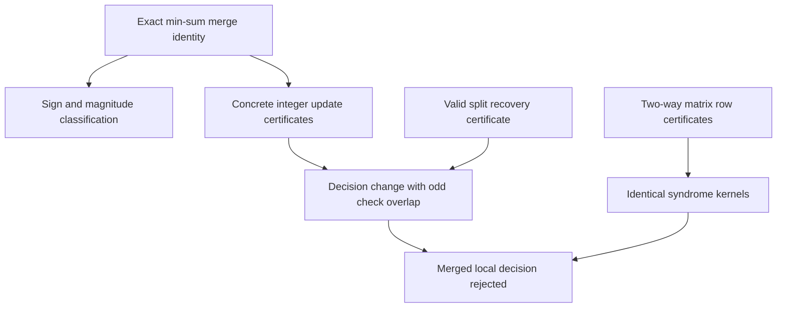

# Why the merged checks can disrupt syndrome convergence

The fixed merger experiment has **1,009 additional syndrome failures** for
Previous best and **1,176** for Minimum 4. We replayed **all 41,181 code/error
pairs whose syndrome-convergence status changed**, retaining both losses and
gains. No new error sample, code, channel, decoder parameter or stopping rule
was introduced.

The precise mechanism is **cross-check parity and minimum-magnitude coupling**.
Merging makes each source-side message depend on the entire other source
check. This can reverse its sign, reduce its magnitude, or do both. Every
first message divergence in the replay cohort has one of those forms.

Lean checks the exact local message identity and classification, a first-state
divergence locality theorem, equality of the two actual parity-check kernels
for each code, and four concrete local syndrome obstructions. Those obstruction
witnesses include valid stabilizer-equivalent split recoveries. Independent
C++/Python replay establishes that the fixed decoder reached the supplied
states; the complete C++ program and 100-step executions are not Lean verified.

## The exact message identity

For an edge on source check A, let X be its other five incoming messages and
Y the full six incoming messages of source B. Put

\[
p_A=s_A\oplus\bigoplus_{x\in X}[x<0],\qquad
p_B=s_B\oplus\bigoplus_{y\in Y}[y<0],
\]
\[
m_A=\min_{x\in X}|x|,\qquad m_B=\min_{y\in Y}|y|,\qquad
N(m)=\min\!\left(50\cdot2^{20},
\left\lfloor\frac{800m+500}{1000}\right\rfloor\right).
\]

The excluded-edge minimum uses the original sentinel when the list is empty;
the actual lists are nonempty and inputs are clipped. The split and merged
messages, evaluated at the **same incoming state**, are exactly

\[
r_A=(-1)^{p_A}N(m_A),\qquad
r_M=(-1)^{p_A\oplus p_B}N(\min(m_A,m_B)).
\]

This includes alpha 0.8, integer rounding, zero-sign conventions and absolute
clipping. It proves a magnitude bound |r_M| <= |r_A|. If the other effective
parity is odd and its minimum is not weaker, the message reverses exactly.
If it is weaker, it can attenuate the message; sufficient attenuation can
prevent a correcting hard-decision flip even without sign reversal. Every
changed message has opposite nonzero sign or strictly smaller magnitude.

Unlike the first-iteration calculation, the effective other parity includes
the signs of its *current* incoming messages. A source with syndrome zero
can therefore reverse the other side later in decoding. A weak message on
either side can also limit all outgoing messages on the other side.

## All first divergences are located and classified

Physical edges have a verified bijection preserving variable incidence.
Before each first message divergence, incoming messages agree under that
bijection. All common-check outputs agree; only the twelve merged-source
edges can change. The message identity classifies those changes. Shared
variable updates then propagate them to later messages and hard decisions.

The Lean abstract iteration theorem proves that differing internal states,
with shared initial state and variable update, require a prior affected-edge
message difference at an equal-input state. Its common-check/shared-update
hypotheses are checked by the concrete edge mapping and replay assertions;
this is not presented as an extracted formal implementation of C++.

The table partitions observed syndrome-match losses and gains by their first
message onset. A mixed onset has both sign reversals and attenuated messages,
possibly on different source edges.

| Code | First message onset | Lost syndrome matches | Gained syndrome matches | Net additional syndrome failures |
| --- | --- | ---: | ---: | ---: |
| previous_best | sign_only | 4,967 | 4,258 | +709 |
| previous_best | attenuation_only | 3,164 | 2,991 | +173 |
| previous_best | mixed | 2,715 | 2,588 | +127 |
| previous_best | **Total** | **10,846** | **9,837** | **+1,009** |
| minimum_4 | sign_only | 4,936 | 4,167 | +769 |
| minimum_4 | attenuation_only | 3,129 | 2,888 | +241 |
| minimum_4 | mixed | 2,772 | 2,606 | +166 |
| minimum_4 | **Total** | **10,837** | **9,661** | **+1,176** |

This is an exact partition of the finite sample, not an allocation of separate
causal effects to sign and magnitude. The same onset classes occur in rescued
runs. A sign-only onset can develop magnitude differences later, and neither
onset class is sufficient for eventual failure. First message divergence is
in iterations 1–5; the earlier full-cohort hard-decision summaries have median
first divergence four for rescued and harmed pairs.

## Which observed states actually lose an accepting transition?

At each recorded state we evaluate both existing source-check update rules
using identical incoming messages and keep common-check outputs fixed. These
diagnostic outputs are never fed into a subsequent iteration. This isolates
a local update difference at that state; it is not a new decoder simulation.

There are two distinct witness types:

1. At an original run's accepting terminal state, does the merged local update
   destroy syndrome acceptance at that same input state?
2. In an actually failed merged trajectory, is there an observed state where
   the split local update would accept, while the actual merged update rejects?

| Code | Lost syndrome matches | Original accepting state disrupted | Actual failed merged paths with a split-accepting observed state |
| --- | ---: | ---: | ---: |
| previous_best | 10,846 | 289 (2.66%) | 5 (0.046%) |
| minimum_4 | 10,837 | 335 (3.09%) | 5 (0.046%) |

These counts use lost matches as denominator; they are not fractions of the
net penalty and should not be added as disjoint causal contributions.
In most lost-match cases, applying the merger to the original accepting
state would still accept. The actual merged trajectory instead reaches a
different sequence of incoming states. That locates the remaining explanatory
work in trajectory propagation and convergence, rather than a changed stopping
test or a universally blocked terminal decision.

The frozen replay also records truth-bit agreement/disagreement crossings
under same-state local evaluations. Fields named `harmful_coupling_*` and
`beneficial_coupling_*` use the original physical error string as that reference.
They are not stabilizer-invariant quantum success measures and are **not used
to claim quantum recovery harm or explanatory coverage here**. All reported
failure classifications use syndrome and the full stabilizer span.

## Four concrete Lean-checked obstructions

For each code we retain the first original accepting-state obstruction and
the first actually failed merged-path obstruction in fixed stream order.
The split decision is a valid recovery in every selected case: either the
true error itself or a correction differing by an explicit original Z check.
Lean proves that membership in the unchanged full Z-stabilizer span.

| Code | State type | Error index | Iteration | Variables changed by the merged local update | An odd-overlap original check |
| --- | --- | ---: | ---: | --- | ---: |
| minimum_4 | original | 2990 | 9 | [71, 168] | 29 |
| minimum_4 | merged | 37476 | 99 | [117] | 33 |
| previous_best | original | 6792 | 8 | [189] | 49 |
| previous_best | merged | 241107 | 58 | [84] | 0 |

The original/merged matrices have identical zero-syndrome words **for every
word**, proved using explicit two-way row-combination certificates over ZMod 2.
Consequently a nonzero original syndrome is also rejection by the actual
merged matrix. The proof does not rely on an empirically checked rank alone.
Original X and Z rows are also bridged to the explicit lift-14 construction;
matrix dimensions, coordinate bounds and absence of duplicate row entries
are checked in Lean.

For each local witness, Lean checks all twelve source-edge update equations
with actual integer rounding/clipping, their hard-decision bits, unchanged
off-source decisions, and the source syndromes of the actual error. The
decision change has odd overlap with a named check. By syndrome linearity,
that converts a split accepting decision into a rejected merged decision.

For example, in Minimum 4 error 37,476 at iteration 99 of the *actual merged*
trajectory, the relevant source variable is 117. Its two common incoming
messages are -2,836,948 and -116,057. With prior 3,332,431, their sum plus prior
is 379,426. The split check sends -2,592,987, producing posterior -2,213,561
and decision one. The merged check sends +333,850, producing posterior
+713,276 and decision zero. The split decision equals the true error, whereas
the merged decision omits bit 117. Its odd overlap with check 33 obstructs
syndrome matching. The run remains a syndrome failure at iteration 100.

This state combines sign reversal with attenuation: the other source has
syndrome zero but a negative incoming message, whose small magnitude also
limits the merged output. Lean checks the numerical local obstruction;
independent replay checks reachability and the final 100-iteration result.
It does not prove this local event makes future recovery impossible.

The Previous best failed-path witness at error 241,107, iteration 58, changes
bit 84. Here the split decision differs from the true error by a Z stabilizer;
it is still valid recovery. This is why the certificates include stabilizer
membership rather than treating bitwise equality with the error as necessary.



## What is proved, measured, and still unresolved

**Lean proved:** the exact merged message law; magnitude bound and complete
changed-message classification; first-round thresholds and an attenuation
barrier; an abstract affected-origin theorem; identical kernels of both
actual matrix pairs; four concrete local accepting-to-rejected updates with
valid split recovery; and two observed attenuation-only onset calculations.

**Replayed and measured:** every one of the 41,181 syndrome-discordant pairs;
the onset partition and local acceptance-opportunity counts; 54 actual C++
incoming/check-message states independently matching direct Python equations;
and 384 retained local source updates. The original performance estimates
remain those of the unchanged [million-error experiment](MERGED-MILLION.md).

**Still unresolved:** a structural criterion predicting which of the two
trajectories converges by iteration 100, a complete explanation of the net
penalty from a small set of sufficient failure conditions, and isolated causal
attribution to absorbing count. The local obstruction has limited measured
coverage; the onset identity explains where divergence begins, not why every
resulting trajectory fails. Check degrees and routing still change together.
No new source question is marked solved by these supporting results.

## Reproduce, inspect, and audit

- [General Lean mechanisms](../dyadic-rank/CyclicMergedMessages.lean)
- [Concrete matrix and state certificates](../dyadic-rank/CyclicMergedWitnesses.lean)
- [Fixed follow-up protocol](MERGED-MECHANISM-PROTOCOL.md)
- [All replay summaries and retained local witnesses](search/merged-mechanism-results.json)
- [Four independent obstruction witnesses and matrices](search/merged-mechanism-witnesses.json)
- [Independent replay checks](merged-mechanism-checks.log)
- [General Lean check](merged-mechanism-lean-check.log)
- [Concrete Lean check](merged-witnesses-lean-check.log)
- [Verification manifest](merged-mechanism-verification.json)

```sh
# Repository root; standard-library Python and a C++17 compiler
python3 formalization/cyclic-lifts/search/merged_mechanism.py
python3 scripts/validate_cyclic_merged_mechanism.py
python3 formalization/cyclic-lifts/search/generate_merged_mechanism_lean.py

# Existing pinned Lean/mathlib environment
cd formalization/dyadic-rank
lake env lean -o .lake/build/lib/lean/CyclicMergedMessages.olean CyclicMergedMessages.lean
lake env lean CyclicMergedWitnesses.lean
```

The proofs use kernel computation and standard proof tactics, with no admitted
proofs, custom axioms or native-decision trust shortcut. Axiom reports are
included for principal endpoints. The scope is local decoder mathematics and
concrete state certificates, with externally checked execution bridges.

The million-error experiment was pushed at commit 8e6efb6. This follow-up
and its new Lean proofs are included in the repository. The paper PDF has not
been rewritten.
