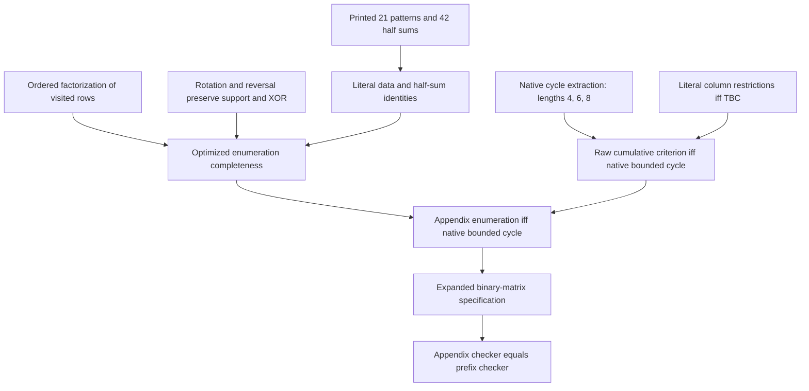

# Fully checked P11 appendix enumeration

Checked October 23, 2026. The remaining source-specific mathematical correspondence is now proved in [DyadicForbiddenAppendix.lean](../dyadic-rank/DyadicForbiddenAppendix.lean). It connects the literal appendix pattern enumeration to the original prefix checker and to native cycles in the expanded binary matrix. This completes the recorded cycle/girth interpretation of inventory target **L-P11-forbidden**.

The source is Gómez-Fonseca, Matthews, Morris and Pllaha, *Combinatorial Analysis of Dyadic and Quasi-Dyadic Codes*, arXiv:2605.01942v1. The question is in Section 7, the forbidden-set contract in Definition 4.20/Remark 4.21, six-step sums in Theorem A.4, and the 21 eight-step classes and 42 half-path expressions in Theorem A.6 and its preceding list. [Primary source](https://arxiv.org/html/2605.01942v1) · [PDF pages 24–29](https://arxiv.org/pdf/2605.01942v1#page=24). The [earlier source comparison](SOURCE-COMPARISON.md) explains the cumulative interpretation and credits the 2023 forbidden-set and cycle-counting predecessors.

## Exact open question and what we answered

In Section 7, Gómez-Fonseca, Matthews, Morris and Pllaha ask “whether forbidden sets are complete for lengths 6 and 8 pathologies.” This is an explicitly posed open question, rather than a numbered conjecture. The same sentence also asks which optimization objectives best correlate with decoding performance, with cycle counts as an example. [Source, Section 7](https://arxiv.org/html/2605.01942v1#S7).

| Part of the source question | Our answer | Status |
| --- | --- | --- |
| Completeness of forbidden sets for lengths six and eight | The literal appendix-derived enumeration detects exactly the shift candidates whose resulting expanded Tanner graph contains a simple cycle of length at most the threshold. Both directions, and the optimized enumeration correspondence, are proved in Lean. | Answered for the cumulative cycle/girth contract of Definition 4.20. |
| Which optimization objectives best correlate with decoding performance | Completeness establishes the correctness of a short-cycle exclusion constraint; it does not establish which cycle counts or other objectives best predict decoding outcomes. | Not answered by this P11 investigation. |

The cumulative qualification matters: the threshold-eight set also excludes candidates producing four- or six-cycles. We do not identify every eight-step closed walk with a simple eight-cycle, nor interpret “pathologies” as every harmful decoding configuration. The theorem applies to finite arrays of dyadic permutation blocks and absent blocks, as modeled in the source-derived procedure.

A direct consequence is that excluding every candidate in the threshold-six or threshold-eight forbidden set rules out all cycles up to that threshold in the completed candidate array. When such a graph has a cycle, its girth is therefore at least eight or ten, respectively. This is a graph-theoretic correctness guarantee, not a guarantee that an admissible candidate exists or that a PEG construction can reach the target girth.

The source also proposes broader absorbing-set/error-floor and construction questions. Those remain outside this completeness result. Our earlier absorbing/stopping-set results and decoding experiments for P34 concern a different graph model and do not automatically settle the P11 performance question. We credit the source's published pattern analysis and the standard voltage-walk framework; answering this recorded question does not by itself establish priority for a new mathematical result.

## Main checked result

The executable function `appendixForbiddenCheck B slot g a` scans the appendix families, ordered embeddings of their used row names, and column tuples. It checks occupied blocks, row/column restrictions and the literal half-sum equations. It contains no base-walk enumeration, expanded-graph search or prefix-simplicity oracle.

For `g ∈ {4,6,8}`, the theorem `appendixForbiddenCheck_eq` proves

```lean
appendixForbiddenCheck B slot g a = forbiddenCheck B slot g a
```

`appendixForbiddenCheck_spec` proves that either side is true exactly when the Tanner graph of the expanded binary matrix has a native simple cycle of length at most `g`. `appendix_dyadic_six_eight` specializes the equality to `Fin ell → ZMod 2` at both requested thresholds. The result covers every finite array size, arbitrary missing blocks, all fiber dimensions including zero, and preexisting short cycles. There is no connectedness, normalization, lower-girth or minimum-four-row hypothesis.

The generic proof works for an additive commutative group with a `ZMod 2` module structure. Array check rows have a linear order, as their integer indices do in P11; variable columns need only be finite and decidable. The candidate cell is indexed `(variable, check)` in Lean, corresponding to `(check row, variable column)` in the paper/Python. `binaryExpansion` puts check/fiber pairs on matrix rows.

## Literal source data and conditions

- `PrintedIndex` restores the PDF's ordering of the 21 row classes; the earlier certificate's entries 12–15 were ordered differently.
- `LeftTriple` and `RightTriple` record the row triples in **all 42 printed half-path sums**. `literal_triples_match` is a finite kernel proof matching every pair to its printed row word. `literal_halves_match` proves that their evaluations are exactly the corresponding four-term sums, with the right half's column order reversed.
- `Enum2` uses one rectangle class. `Enum3` uses the literal two triple-sum expressions of A.4, with ordered distinct row labels. `Enum4` uses the 21 printed classes and their literal two four-term expressions.
- `paper_columns4_iff` proves that the source's four column inequalities are precisely cyclic adjacent-column distinctness. `polygon2_tbc`, `polygon3_tbc` and `polygon4_tbc` prove the corresponding native TBC conditions, including the closing junction.
- `Supported` requires every participating block to be present. Missing blocks cannot accidentally contribute zero labels to a successful equation.
- `PrefixCode` omits duplicate classes that skip a sorted row rank. `StrictUsed` requires an increasing embedding only on names actually used by the selected pattern. Unused entries in the total encoding function are padding and do not require fictitious additional rows. Their values do not affect membership; the theorem concerns the resulting forbidden set, not duplicate counts or runtime complexity.

The source's 21 classes therefore remain explicit. Ordering the distinct visited rows and omitting unused-name duplicates is the same membership optimization used by the Python reconstruction. All low-row cases are included. This is not an assertion about the identity of author software that was not published with the paper.

## Proof dependencies



`ordered_factor` sorts the set of visited rows and encodes each by its rank, proving that the used-name embedding is increasing. `classify2`, `classify3` and `classify4` select an appendix representative after rotating or reversing the word. `proper_reindex`, `supported_reindex` and `total_reindex` prove that this operation preserves every required condition. A reversal shifts the column index by one: `rowAt` uses `shift-i`, whereas `colAt` uses `shift-i-1`. This detail is part of the proof, not an informal convention.

`raw2_of_base`, `raw3_of_base` and `raw4_of_base` decompose actual alternating base walks and recover their row/column data, support, TBC inequalities and half-sum equations. Conversely, `raw2_sound`, `raw3_sound` and `raw4_sound` build the corresponding native base walks and invoke the checked TBC lifting theorem. A closed nonbacktracking walk can repeat a shorter cycle, but contains a simple cycle no longer than itself. The cumulative forbidden-set test is therefore correct without asserting an incorrect exact-length cycle count.

`raw_cumulative_complete` uses the Tanner bipartition to exclude odd cycles and the native cycle minimum length to reduce every cycle of length at most eight to lengths four, six or eight. `enum2_complete`, `enum3_complete` and `enum4_complete` then finish the literal optimized-enumeration correspondence.

## Verification and scope

The new proof file has **49 audited declarations**. The complete investigation has **90 audited library declarations** (23 original prefix/matrix lemmas, 18 TBC/source lemmas and 49 literal-appendix lemmas), plus **two separately audited kernel-evaluated execution checks** in [DyadicForbiddenAppendixChecks.lean](../dyadic-rank/DyadicForbiddenAppendixChecks.lean). The execution checks cover the parity-sensitive `2×2` example and an array with zero check rows. These finite checks are regression evidence; the general theorem does not depend on their test coverage.

The axiom audits use only `propext`, `Classical.choice` and `Quot.sound`. There are no admitted proofs, native-evaluation axioms or additional cycle-correspondence assumptions. The pinned Lean/Mathlib versions, source hashes, build output and individual axiom reports are recorded in [verification.json](verification.json).

Reproduce from `formalization/dyadic-rank`:

```sh
lake -f lakefile-forbidden.toml build
lake -f lakefile-forbidden.toml env lean DyadicForbiddenAppendix.lean
lake -f lakefile-forbidden.toml env lean DyadicForbiddenAppendixChecks.lean
```

From the repository root:

```sh
python3 scripts/validate_dyadic_forbidden.py
```

This completes a source-specific completeness proof for cumulative short-cycle forbidden sets. It does not certify A.6's numerical multiplicity coefficients, optimality of PEG choices, suppression of every absorbing/decoding pathology, or any unpublished author program. The general voltage-walk principle and published pattern analysis receive their existing attribution; no claim of a new mathematical theorem or first formalization is made. The earlier dyadic and cyclic manuscript snapshots remain unchanged.
